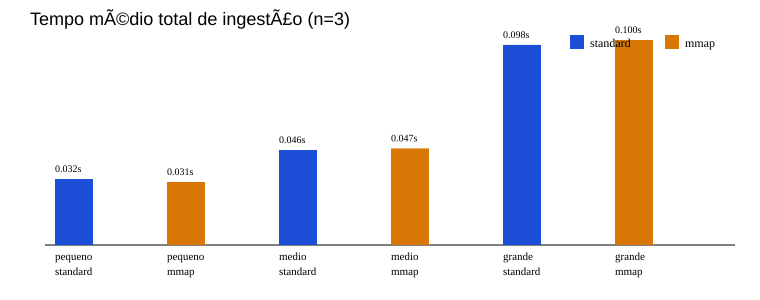

# Relatório individual — Ingestão e Armazenamento do GenResearch-Servidor

## 1. Escopo e objetivo

Esta contribuição implementa e valida o pipeline local de ingestão do GenResearch-Servidor. O escopo compreende leitura recursiva de arquivos `.txt` UTF-8, fragmentação por palavras, vetorização determinística simulada e persistência em SQLite. Não inclui servidor HTTP, fila, cache, geração de respostas ou avaliação de qualidade de recuperação. A identificação pessoal não foi incluída porque não há responsável individual confirmado para esta parte no repositório.

## 2. Ambiente e método

A coleta foi executada em 19/10/2026 no Windows 11 (10.0.26200), AMD64, Python 3.14.7 e 12 CPUs lógicas reportadas. O commit de referência era `def19e2`; a árvore tinha alterações locais não commitadas, incluindo esta implementação e as evidências. Não há dependências externas: SQLite é acessado pela biblioteca padrão. O ambiente não é Linux/WSL; por isso `/proc`, `getrusage` Linux, faltas menores/maiores, VSZ, RSS de pico e contadores de I/O não foram coletados. Não se alterou cache de páginas ou configuração global; processos novos não equivalem a cache frio.

O script `experimentos/scripts/benchmark_ingestao.py` gerou corpus determinístico com a semente `genresearch-so-2026-2-seed-01`. Foram feitas três repetições por modo, em ordem alternada standard/mmap, mmap/standard, standard/mmap. Cada repetição iniciou novo processo Python e banco SQLite exclusivo, eliminando o efeito da deduplicação na medição. Parâmetros comuns: 200 palavras por trecho, sobreposição de 40 palavras e 128 posições por vetor.

| Corpus | Documentos | Bytes reais |
|---|---:|---:|
| pequeno | 10 | 34940 |
| medio | 76 | 265610 |
| grande | 300 | 1048690 |

## 3. Pipeline, vetores e armazenamento

`standard` usa leitura convencional de bytes; `mmap` mapeia o arquivo apenas se não vazio, fecha arquivo e mapeamento, e então materializa `mapped[:]` para decodificar UTF-8. Portanto, mmap não elimina a cópia de bytes/texto nesta implementação. Os trechos preservam caminho relativo, identificador do documento e posição ordinal. O arquivo vazio é ignorado e erro de decodificação é registrado sem encerrar toda a ingestão.

Os vetores são simulados: SHA-256 do texto com contador, expandido para dimensão configurável e normalizado em L2; o formato persistido é `float32-le`. O mesmo texto é reproduzível entre processos, mas o vetor não representa semântica e não valida a qualidade de recuperação. A recuperação recebe lotes por `SQLiteIndex.iter_chunk_vectors(batch_size=128)`.

SQLite guarda `documents` (caminho relativo, bytes e SHA-256), `chunks` (documento, posição e texto), `vectors` (BLOB, dimensão e formato), `index_config` e `ingestion_runs`. Reingestão idêntica não duplica registros; conteúdo alterado substitui o documento e seus dependentes. Mudanças de dimensão, tamanho ou sobreposição exigem `--rebuild`, que torna a remoção explícita. O banco não utiliza WAL: o tamanho medido é somente o arquivo `.sqlite3` gerado em cada repetição.

Tamanho do corpus é a soma dos bytes dos textos de entrada. Volume dos vetores é a soma medida dos BLOBs (`n_vetores × 128 × 4`); tamanho do SQLite inclui páginas, índices, textos, metadados e os vetores, portanto não é igual ao volume de vetores nem mede E/S física.

## 4. Testes funcionais

`python -m unittest discover -s tests -v` executou 6 testes e todos passaram. Eles verificaram: fragmentação e sobreposição; validação de parâmetros; vetores reprodutíveis e normalizados; persistência, reabertura e leitura em lote; reingestão sem duplicação; equivalência do índice standard/mmap; corpus inexistente; arquivo vazio; subpasta; documento modificado; configuração divergente que requer reconstrução; e UTF-8 inválido tratado como erro registrado. Durante a validação, foi corrigido apenas o coletor: o processo-filho passou a usar `-X utf8`, pois o codepage do console do Windows impedia o coletor de decodificar seu JSON. Não houve correção funcional necessária no pipeline.

## 5. Resultados reais da coleta

| Corpus | Modo | Média total (s) | Mediana (s) | DP amostral (s) | Média leitura (s) |
|---|---|---:|---:|---:|---:|
| pequeno | standard | 0.032222 | 0.032998 | 0.003157 | 0.000664 |
| pequeno | mmap | 0.030746 | 0.029642 | 0.002126 | 0.000835 |
| medio | standard | 0.046374 | 0.047155 | 0.004370 | 0.005170 |
| medio | mmap | 0.047141 | 0.044832 | 0.005208 | 0.005793 |
| grande | standard | 0.097683 | 0.099653 | 0.004029 | 0.019726 |
| grande | mmap | 0.100051 | 0.096948 | 0.006811 | 0.022369 |



Os resultados brutos contêm 18 linhas e mostram, em todas as repetições, as mesmas contagens para cada corpus e modo. No corpus médio, mmap teve média total menor (0,053986 s versus 0,061417 s); no grande, standard teve média menor (0,119132 s versus 0,129144 s). As amostras são pequenas (n=3) e os tempos são curtos; não foi calculado p95 por baixa representatividade. Logo, os dados não sustentam uma conclusão geral de superioridade do mmap.

## 6. Relação com Sistemas Operacionais e limitações

No modo convencional, a aplicação solicita leitura de arquivo ao sistema; no modo mmap, o espaço de endereçamento recebe um mapeamento e o sistema operacional pode trazer páginas sob demanda. Ambos estão sujeitos ao cache de páginas, que não foi controlado. SQLite adiciona buffers, índices, transações e páginas de armazenamento; por isso o crescimento do índice não é somente o crescimento dos vetores. A fragmentação por documento evita carregar o corpus completo de uma vez, mas cada documento ainda é lido e decodificado integralmente antes de ser fragmentado.

Não foram medidos pico de RSS, VSZ, faltas de página ou contadores de E/S; não são inferidos de uma amostra. Também não houve teste em Linux/WSL nem controle de cache frio. A comparação avalia custos do pipeline com vetores simulados, não qualidade semântica, concorrência ou sincronização.

## 7. Reprodução e integração

```bash
python -m unittest discover -s tests -v
python experimentos/scripts/benchmark_ingestao.py
python experimentos/scripts/generate_relatorio_ingestao.py
```

Os dados ficam em `experimentos/genresearch/evidencias/`: `raw_results.csv`, `summary.csv`, `corpora.json`, `environment.json`, bancos individuais e resumos JSON. O restante do projeto pode abrir `SQLiteIndex(caminho).iter_chunk_vectors(128)` para consumir texto, origem, posição e vetor em lotes.

**Texto para a tabela de contribuições:** “Implementação e validação da ingestão recursiva de corpus, fragmentação configurável, vetores simulados determinísticos, persistência SQLite, testes funcionais e experimento comparativo entre leitura convencional e mmap.”
